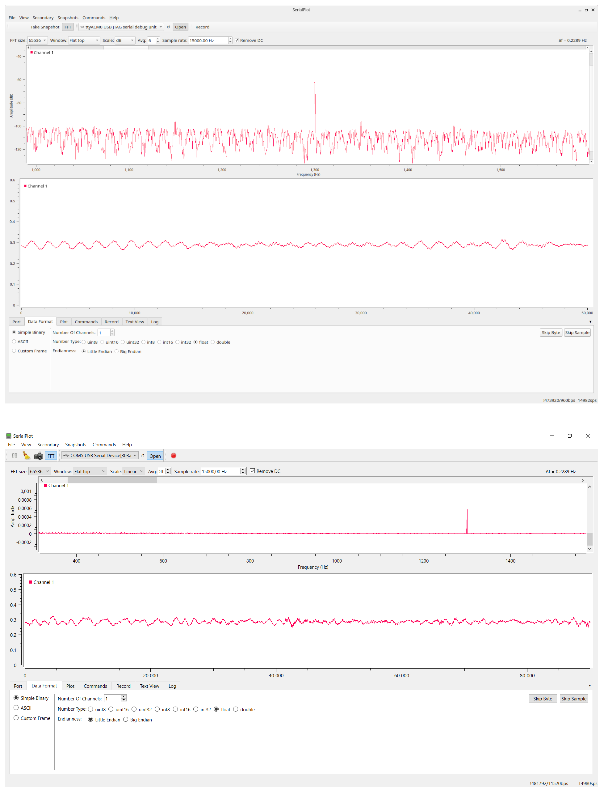

# SerialPlot

Small and simple software for plotting data and its fast Fourier transform (FFT) from serial port in realtime.
This is a forked and modified SerialPlot version from the original creator: https://github.com/hyOzd/serialplot

I have found SerialPlot highly useful in various instances, in my pinion, the only thing missing was a realtime FFT capability. 
You will find FFT a real life-saver when working with weak periodic signals.

This modification of SerialPlot has been developed while working on Latvian Council of Science project "New generation of piezoelectric materials for active vibration control" (LZP-2023/0571). The software was used to detect small oscillation in the laser-interferometer setup.




## Features

* Reading data from serial port
* Binary data formats (u)int8, (u)int16, (u)int32, float
* User defined frame format for robust operation
* ASCII input (Comma Separated Values)
* Synchronized multi channel plotting
* Define and send commands to the device in ASCII or binary format
* Take snapshots of the current waveform and save to CSV file
* Real time FFT of the incomming data streamTake snapshots of the current waveform and save to CSV file
* FFT sample size between 1024 (for faster plotting) and 65536 (for more accurate readings) in steps of multiples by two
* Choice of the most popular windowing functions for FFT
* FFT scale choice between linear and dB, db is calculated as follows: $\text{dB} = 20 \cdot \log_{10}(V / 1)$.


## Installation

Check the releases page.

## Dependencies

- Qt 6, including SerialPort module
- Qwt 6.3

## Building

### Obtain Dependencies

- Qt6 development packages
- Qt SerialPort module
- CMake
- git

Under Ubuntu/Debian:
```apt install qt6-base-dev qt6-serialport-dev qt6-svg-dev git cmake build-essential```

### Download and Install Qwt [You can skip this step]

[Qwt](http://qwt.sourceforge.net) is the library that provides
plotting widgets for SerialPlot. You have 3 different options for Qwt.

* Leave it to serialplot build scripts. Qwt will be downloaded and built for you.

* Download Qwt 6 [here](http://sourceforge.net/projects/qwt/files/)
  and build it yourself per these
  [instructions](http://qwt.sourceforge.net/qwtinstall.html#qwtinstall-unix)
  and install. Make sure you use Qt6 to build. When calling cmake for
  serialplot, `BUILD_QWT` cmake option to `false`. If you didn't
  install qwt after building point `QWT_ROOT` variable to `qwt/`
  directory that you have just built.

### Download and Build SerialPlot

You can use git to download SerialPlot source code. 

    git clone https://github.com/hyOzd/serialplot
    cd serialplot
    mkdir build && cd build
    cmake ..
    make -j

## License

This software is licensed under GPLv3 excluding some third party
files. See file COPYING for details.
